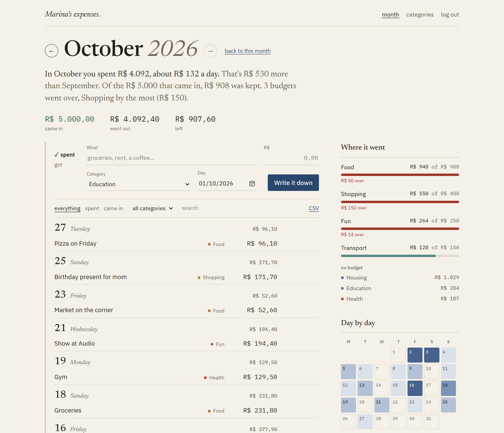
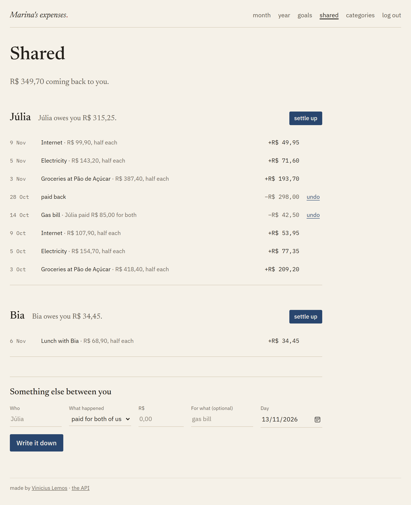
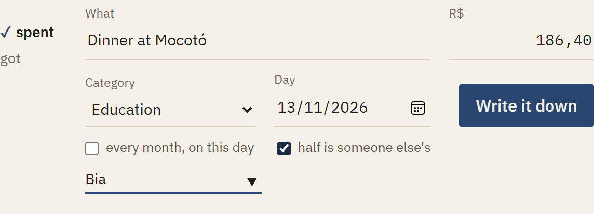
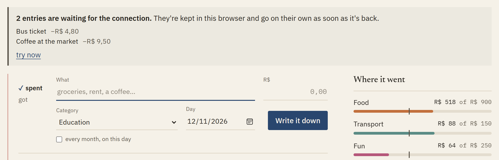
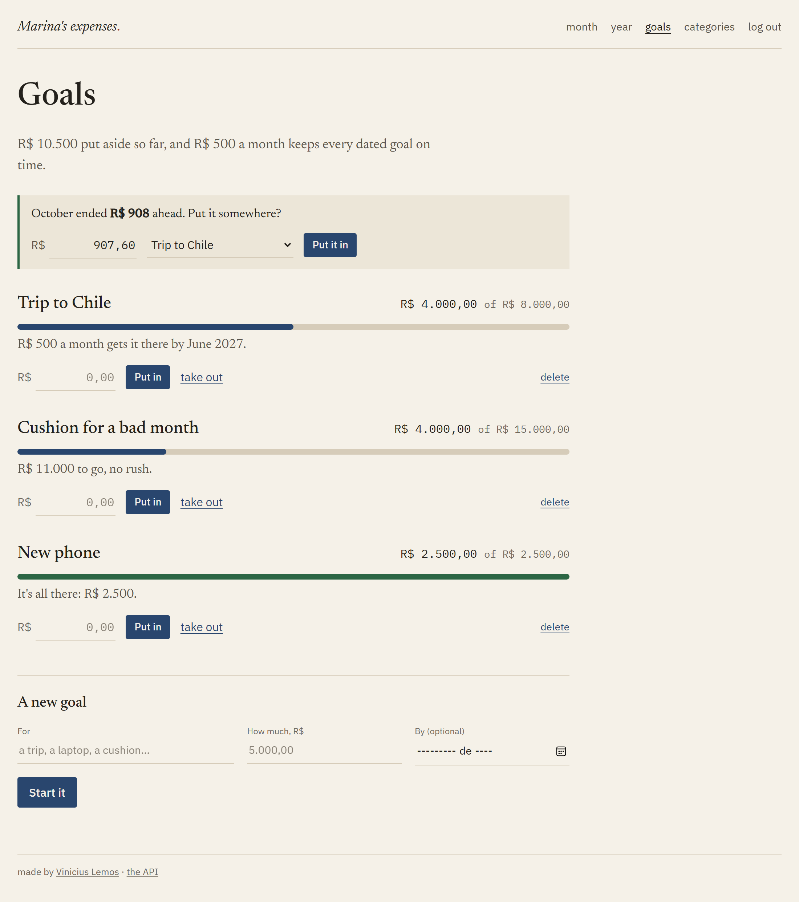
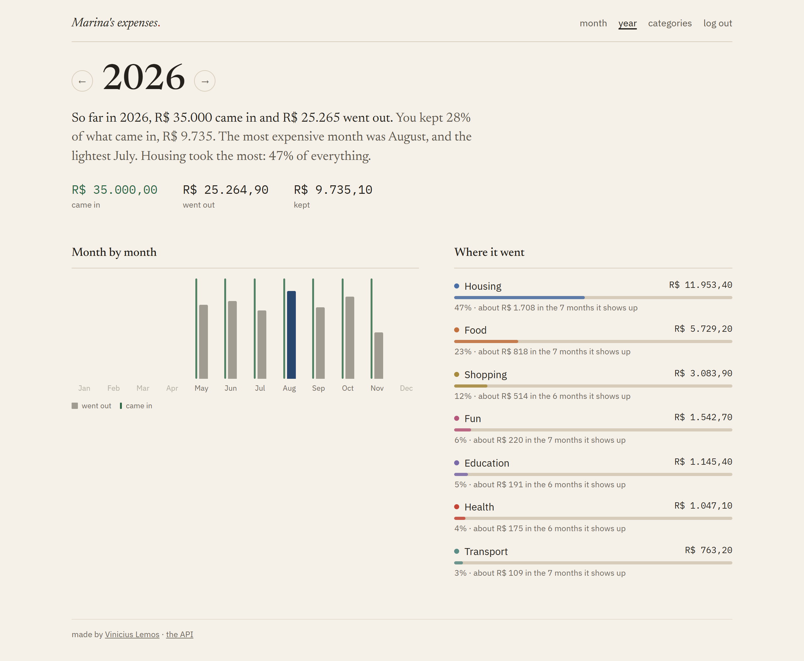
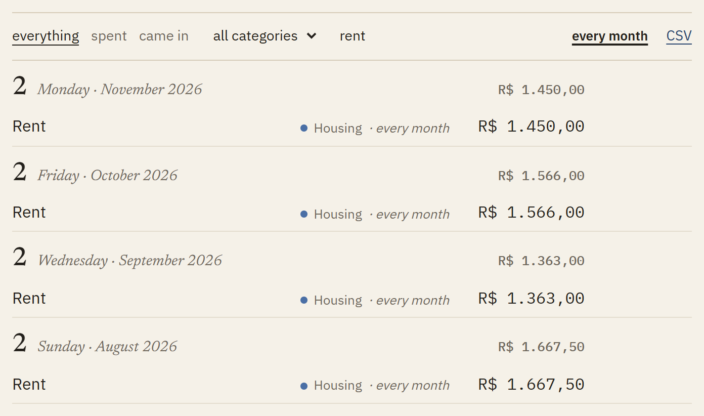
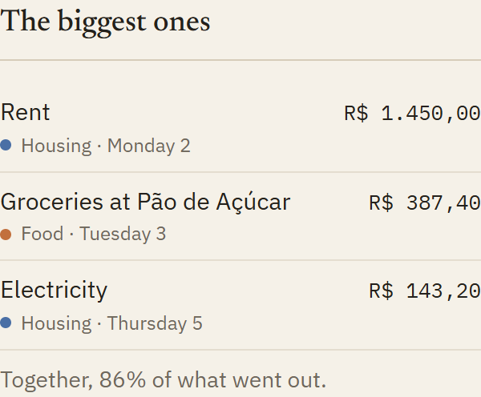
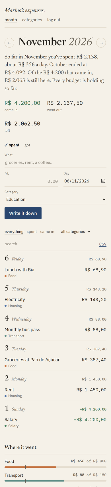
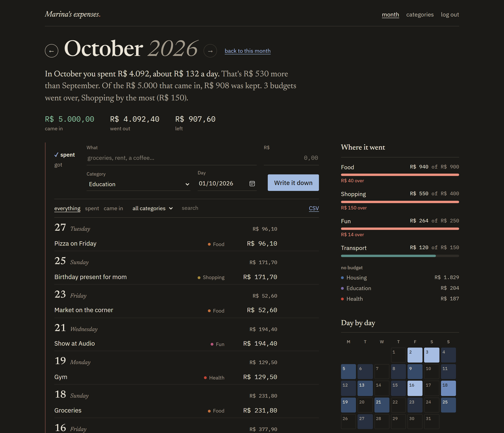

# Expense Tracker


Write down what you spend and what comes in, and at the end of the month read how it went, in plain words: what you kept, which budget slipped, which days cost the most.

React on the page, a Python API (FastAPI) and Postgres behind it.

What's there today:

- **The month:** entries by day, the month in sentences, budgets per category, a calendar of the days that cost the most, the biggest expenses, and search across every month.
- **The year:** twelve months side by side, what was kept, where it went.
- **Goals:** money put aside for something, with how much a month gets it there.
- **Shared:** half of an expense can be someone else's, and the page keeps who owes what.
- **Less typing:** bills that come every month written on their own, suggestions of which ones should be, and the bank's CSV statement read straight in.
- **No signal:** entries written offline wait and go when the connection is back.

**Try it:** [expense-tracker-qm7l.onrender.com](https://expense-tracker-qm7l.onrender.com). The *Open Marina's notebook* button logs in as a made-up person with six months written down. It's a free instance, so the first visit after a while takes up to a minute.



It started as a React app that saved everything in the browser. That's fine until you want the same numbers on the phone and on the computer, so now there are accounts and a server, and the page was redone from scratch on top of them.

## The page

I wanted it to feel like the notebook people actually use for this, not like a dashboard. So there's cream paper, a blue pen, ruled lines and a red margin. The figures are in a mono font so the columns line up.

- **The month in sentences.** Instead of three boxes with numbers at the top, it says something like *"In October you spent R$ 4.092, about R$ 132 a day. That's R$ 530 more than September. Of the R$ 5.000 that came in, R$ 908 was kept. 3 budgets went over, Shopping by the most."* A month that's still going isn't compared with a whole one, because on the 5th it would always look cheaper.
- **Writing an entry is one line.** You pick *spent* or *got*, then type what, how much, the category and the day. The amount can be typed the Brazilian way (`1.234,56`) or the other way (`1,234.56`).
- **Every month, written once.** Rent, salary, the internet bill: tick *every month* when writing it and it gets written down on its own on that day, catching up on months nobody opened the app. A 31st lands on the last day of shorter months. Pausing or stopping keeps what was already there, and deleting one of the generated entries doesn't bring it back. And the ones you forgot to set up get found: the same description in three of the last six months, at about the same amount, shows up on the categories page as *"these look like they come every month"* with **make it automatic** (from the next time it falls, so nothing is written twice) or **no** (and it doesn't come back). `Netflix.com 11/26` and `NETFLIX.COM 10/26` count as the same bill.
- **The entries are grouped by day,** with what went out and came in on each day. You can edit an entry in place. Deleting crosses it out with an "undo" for a few seconds, instead of asking "are you sure?" first.
- **Budgets per category.** In the month that's still going there's a small mark on each bar for where the spending should be by today. 60% of the food budget gone on the 10th looks wrong, and on the 25th it doesn't.
- **A calendar of the month,** each day darker the more went out. Clicking a day jumps to it in the list. The darkest shade goes to the second biggest day, otherwise rent day would make every other day look empty.
- **The biggest ones.** The three largest expenses of the month in the margin, and how much of everything that went out they were together. Usually it's rent and two surprises. Clicking one jumps to its day.
- **The last six months,** and clicking one opens it.
- **The year on one page.** How much came in and went out, the share of it that was kept, the most expensive and the lightest month (only whole months: November isn't light, it just isn't over), the twelve months side by side and where the money went, each category with what it costs in a month where it shows up. Clicking a month opens it.
- **Goals.** Money put aside for something: a trip, a laptop, a cushion for bad months. Each one has an amount and, if you want, a month to reach it by, and then it says how much a month still gets it there (*"R$ 500 a month gets it there by June 2027"*), rounded up so it really does. Putting in and taking out are one field. What's saved is the sum of every move, so there's a history and nothing drifts. When last month ended ahead, the page offers it: *"October ended R$ 908 ahead. Put it somewhere?"*, with the amount filled in minus whatever already went into goals this month.
- **Your bank statement comes in as entries.** Export the CSV from Nubank (account or card), Inter, or any bank that gives a date, a description and an amount, and pick it on the categories page. It finds the header even with lines about the account above it, works out `;` or `,` and `1.234,56` or `1,234.56`, and flips the sign for card statements. Paying the card bill and moving money to savings are left out. Each line gets a category from its words (iFood is Food, Uber is Transport, Mercado Livre is Shopping), and before anything is saved it shows how many and how much. The file is read in the browser, and the same file twice doesn't repeat anything.
- You can filter by kind and category, search, and export the month to CSV, which opens straight in Excel.
- **A search can look in every month,** not only the one open: "when did I last pay the dentist?" With that on, each day in the list also says which month it's from. A search that finds nothing in this month offers to look in the others.
- Categories can be renamed, recolored, archived or deleted. A category that still has entries has to move them to another one before it can go.
- If you used the first version, its backup file can be brought in from the categories page. Bringing the same file twice doesn't repeat anything.
- **Paying for two.** Dinner with a friend, the market and the bills with a flatmate: ticking *half is someone else's* on an expense marks half of it as theirs. It still counts whole in the month, since all of it left your pocket, and the half shows up on the **shared** page as what they owe. Anything else between the two of you goes there too: they paid the gas bill for both (you owe half), they paid you back, you paid them back. Each person gets one sentence (*"Júlia owes you R$ 315,25."*), the last few things that moved it, and a **settle up** button that writes down the payment that squares it. Names are matched without case, so Bia, bia and BIA are one person, and an odd cent stays with whoever paid.

  <p>
    
    
  </p>
- **Writing it down with no signal.** On the bus or at the back of the market the connection drops, and the entry doesn't get lost: it waits in the browser, shown above the page as *"2 entries are waiting for the connection"*, and goes on its own the moment the phone is back online (or the next time the page opens). Each one carries a key made up in the browser, and the API writes an entry with a key it has seen once only, so a reply lost on a bad connection doesn't turn one coffee into two. Logging out forgets whatever was still waiting.

  
- There's a dark mode, it works on the phone, and it can be installed as an app.





<p>
  
  
</p>

<p>
  
  
</p>

### On a phone

The month name and its arrows stay on one line down to 360px, fields are 16px so iOS doesn't zoom in, and the small text buttons (edit, delete, the filters) have a finger-sized hit area. The end to end tests run on a phone too, and the axe check covers the month, the year and the categories in light and dark mode.

## The API

It lives in `api/`, written in FastAPI with psycopg, and the SQL is written by hand.

- Accounts are email and password, hashed with bcrypt. The session cookie is HttpOnly and SameSite=Strict, and only a hash of its token is stored. After 5 wrong passwords in 15 minutes, that email has to wait a while.
- Anything that changes data needs an `X-Requested-With` header. A form on another site can't send it, and there's no CORS, so that covers CSRF.
- The database itself refuses an entry in a category that belongs to another person or is of the other kind. That's a composite foreign key, `(category_id, user_id, kind)`, so it doesn't depend on the Python code remembering to check.
- The list comes 50 entries at a time and pages by `(day, id)` instead of `OFFSET`. Page 40 is as fast as page 1, and nothing gets skipped when entries are added in between.
- `/api/goals` keeps the goals and `/api/goals/{id}/moves` the money going in and out. Taking out more than is there is refused under a row lock, so two taps at once can't both take the last of it. `/api/goals/leftover` says what last month left that hasn't gone into a goal yet.
- `GET /api/shared` is everyone the person shares with and where it stands, worked out from the split expenses and the moves in `shared_moves` (`POST /api/shared/moves`, `DELETE /api/shared/moves/{id}`). An entry takes `split_with` when it's made or edited, and the database refuses it on anything but an expense.
- `GET /api/year/2026` is the year page in one request: twelve months with `generate_series`, so the empty ones are zeros, and the categories with how many months each shows up in.
- `GET /api/dashboard?month=2026-10` brings everything the page needs in one request:
  - the totals, and last month's;
  - each category against its budget;
  - every day of the month (with `generate_series`, so the days with nothing are there too);
  - the last six months;
  - the three biggest expenses.
- Each request uses one connection and one transaction, and the commit happens *before* the answer goes out. Without that, the browser could ask "who am I?" with the new session cookie before the session was saved. The end-to-end tests caught this one.
- Recurring entries keep the *next date* to write, instead of checking "is there one this month?". That's what lets a deleted one stay deleted. The page asks for the list and the month at the same time, so the rows are read with `FOR UPDATE`, and the second request waits and finds nothing left to write.
- The interactive docs are at `/api/docs`.

## Tests

- **API:** 27 tests in pytest, run against a real Postgres.
- **Page:** unit tests in vitest for the money parsing, the calendar and the sentences.
- **End to end:** Playwright clicks through the built page with the real API and database behind it, on a desktop and on a phone size. Then axe checks accessibility, in light and dark mode.
- CI runs all of it, with Postgres in a service container.

## Running

You need Postgres running somewhere.

```bash
git clone https://github.com/ViniciuscLemos/expense-tracker
cd expense-tracker
npm install
pip install -r api/requirements-dev.txt

# the API on :8000 (DEMO=true adds the made-up Marina with six months of entries)
DATABASE_URL=postgresql://postgres@localhost:5432/expenses DEMO=true \
  python -m uvicorn --factory app.main:create_app --app-dir api --port 8000

# the page with hot reload on :5173, passing /api on to :8000
npm run dev
```

Tests:

```bash
npm test                                                  # page, unit
TEST_DATABASE_URL=postgresql://... pytest api             # API
npm run build && E2E_DATABASE_URL=postgresql://... npm run e2e   # end to end
```

## Putting it online

It runs on Render's free plan as one Docker service (`Dockerfile` + `render.yaml`): Node builds the page, then a small Python image serves the page and the API from the same address. The database is a free [Neon](https://neon.tech) Postgres. It shares the Neon project of my [link shortener](https://github.com/ViniciuscLemos/url-shortener): the blueprint borrows that service's `DATABASE_URL` and `DATABASE_NAME=expenses` swaps the database, so the password is never copied by hand. On its own, paste a connection string in `DATABASE_URL` instead.

The free instance sleeps after 15 minutes without visits, so the first visit after that takes a while.

## Some decisions

- Money is stored in cents (integers), in the database and in JavaScript. With floats you get things like `0.1 + 0.2 = 0.30000000000000004`.
- The page and the API share one address, so the cookie can be strict and nothing needs CORS.
- The service worker keeps the page itself for offline opening, but never the API's answers: they're someone's money, and they'd stay in the cache after logging out. Entries written offline are the one thing kept, and only until they're sent.

## Structure

```
api/
  app/main.py         the app: routers, the CSRF check, serving the built page
  app/auth.py         sign up, log in, sessions, the wrong password limit
  app/entries.py      entries: list with filters and paging, add, edit, delete, import
  app/categories.py   categories and budgets
  app/dashboard.py    the month in one request
  app/shared.py       money between two people
  app/demo.py         Marina, the demo account
  migrations/         the SQL
  tests/
src/
  App.jsx             who's logged in, and which page
  components/         Login, Month, EntryLine, Ledger, Budgets, Calendar, SixMonths, Categories
  lib/finance.js      money, months, the calendar
  lib/story.js        the month in sentences
  lib/outbox.js       entries written offline, waiting to go
e2e/                  Playwright
```
